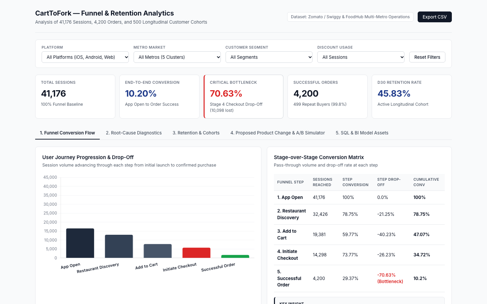
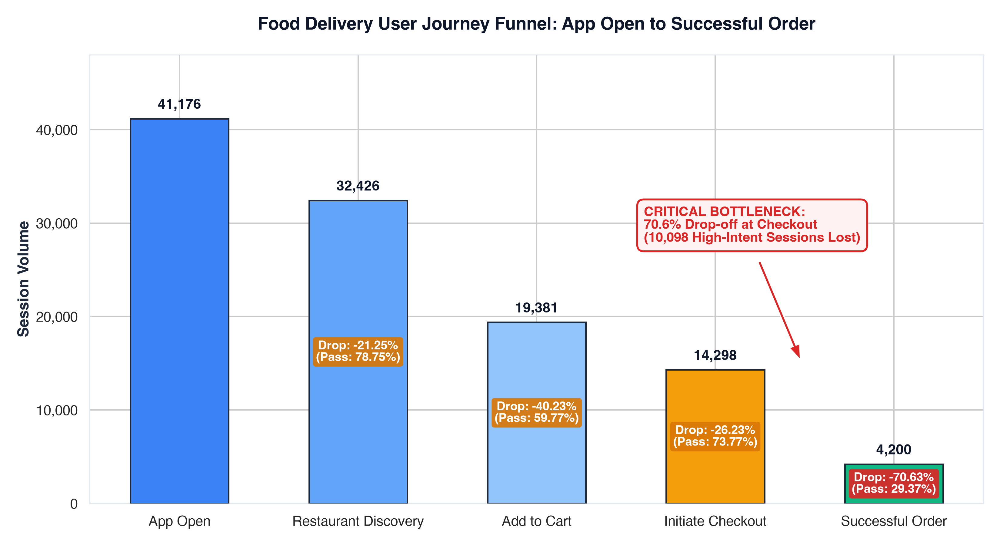
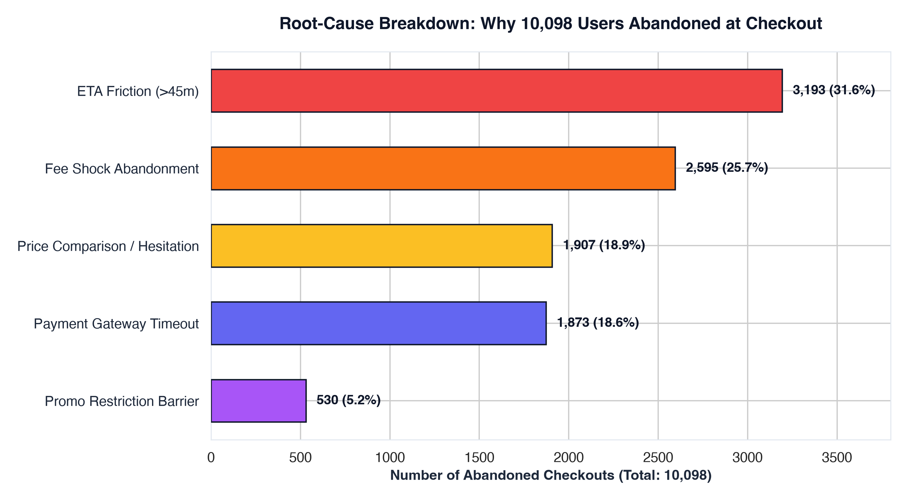
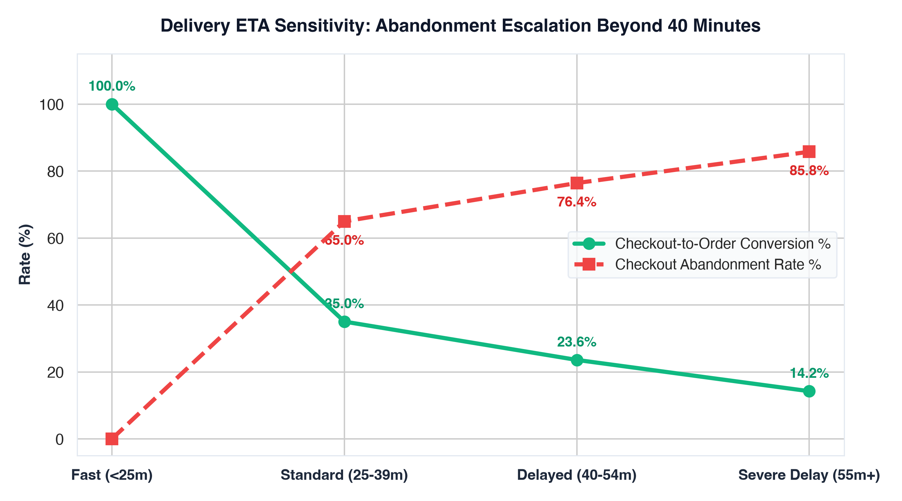
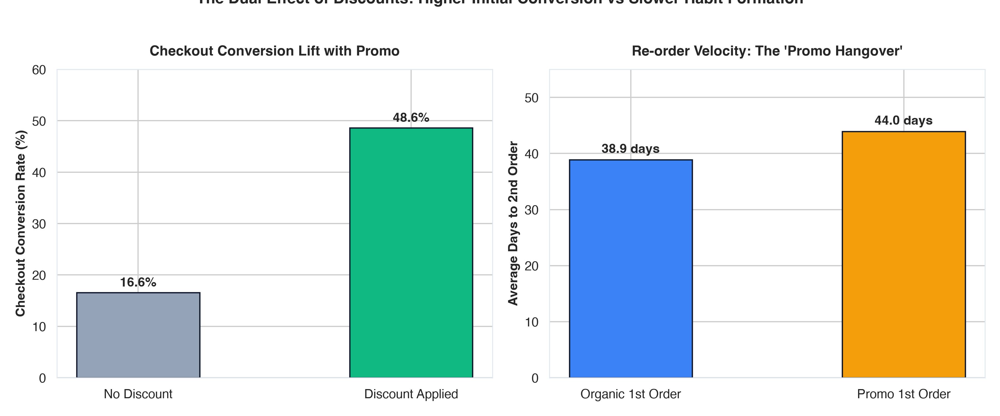
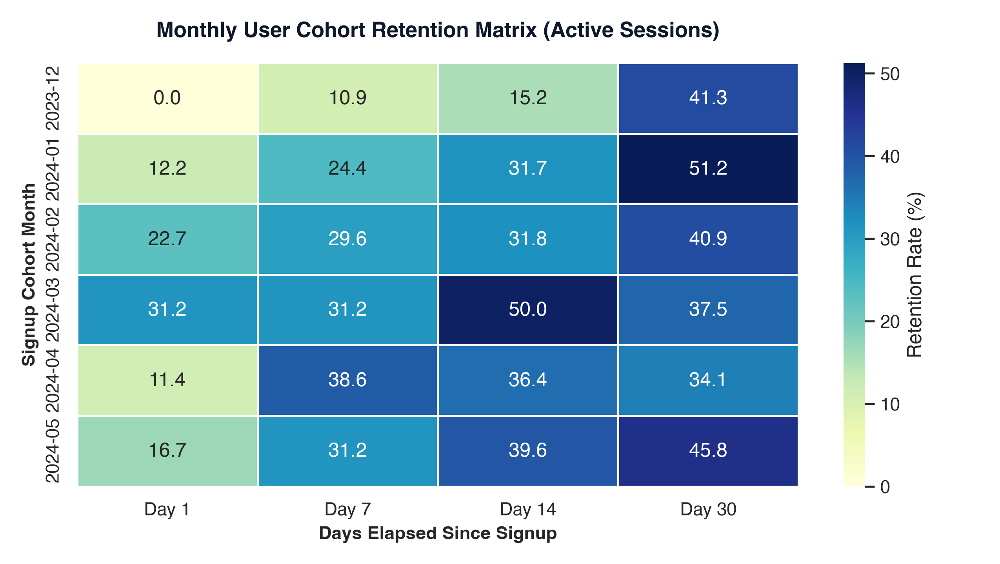

# CartToFork: Food Delivery Product Funnel & Retention Analytics

<div align="center">

[](python/)
[](sql/)
[](bi_powerbi_tableau/)
[](bi_powerbi_tableau/)
[](product_teardown/)
[](LICENSE)
[](https://github.com/gaurav-budhwani/CartToFork)

<p align="center">
  <strong>Product Funnel Analysis, Drop-Off Diagnostics, and A/B Testing Framework for Food Delivery Marketplaces</strong>
</p>

</div>

---



---

## Executive Overview and Business Problem

> **Core Business Question**:  
> *Where are users dropping off before placing an order, and what product changes can improve completion and retention?*

In on-demand food delivery platforms (such as DoorDash, Uber Eats, Zomato, and Swiggy), users browse and compare restaurants freely. However, **drop-off at the final checkout step has direct revenue consequences**. A user who adds items to a cart and proceeds to checkout has already selected items and indicated purchase intent. When that user leaves without completing payment, platform acquisition cost is wasted and transaction revenue is lost.

**CartToFork** provides an end-to-end product analytics study across **41,176 sessions**, **4,200 completed orders**, and **500 customer profiles** across five metropolitan markets (**Mumbai, Bengaluru, Delhi NCR, Hyderabad, and Pune**), derived from operational delivery datasets.

---

## Architecture and Technology Stack

```
+──────────────────────────────────────────────────────────────────────────────────────────────────+
|                                  CARTTOFORK SYSTEM ARCHITECTURE                                  |
+──────────────────────────────────────────────────────────────────────────────────────────────────+
|  1. DATA LAYER          |  2. COMPUTE & MODELING   |  3. BUSINESS INTELLIGENCE  |  4. INTERACTION|
|  • Zomato/Swiggy Orders |  • Python 3.10+ (Pandas, |  • Power BI (DAX Measures) |  • HTML5 / CSS3|
|  • NYC FoodHub Records  |    NumPy, SciPy)         |  • Tableau (LOD Calc Fields|  • Vanilla JS   |
|  • Clickstream Events   |  • ANSI SQL (PostgreSQL, |  • Kimball Star Schema ERD |  • Chart.js    |
|  • User Cohort Profiles |    DuckDB, Snowflake)    |  • Dimensional Data Marts  |  • A/B Calc    |
+──────────────────────────────────────────────────────────────────────────────────────────────────+
```

- **Data Ingestion and Processing**: Python (`pandas`, `numpy`) for cleaning and harmonizing relational operational data into event clickstream logs and session tables.
- **SQL Analytics**: ANSI SQL scripts compatible with PostgreSQL, DuckDB, Snowflake, BigQuery, and SQLite using Common Table Expressions (CTEs), window functions (`LAG`, `LEAD`, `ROW_NUMBER`), and cohort logic.
- **Statistical Analysis and Visualizations**: Python (`matplotlib`, `seaborn`, `scipy`) for computing distributions, drop-off rates, and sensitivity curves.
- **Business Intelligence Modeling**: Star schema specification, Power BI DAX production measures, and Tableau Level of Detail (LOD) calculations.
- **Web Dashboard**: Light-theme dashboard built with HTML5, CSS3, modern typography, and Chart.js, featuring interactive stage filtering and a live A/B test simulation tool.

---

## 1. Funnel Conversion Analysis

Tracking the customer journey across **41,176 sessions** indicates an **overall conversion rate of 10.20%**:

| Funnel Stage | Sessions | Step Conversion Rate (%) | Step Drop-off Rate (%) | Overall Conversion (%) |
| :--- | :--- | :--- | :--- | :--- |
| **1. App Open** | 41,176 | 100.00% | 0.00% | **100.00%** |
| **2. Restaurant Discovery** | 32,426 | 78.75% | 21.25% | **78.75%** |
| **3. Add to Cart** | 19,381 | 59.77% | 40.23% | **47.07%** |
| **4. Initiate Checkout** | 14,298 | 73.77% | 26.23% | **34.72%** |
| **5. Successful Order** | **4,200** | **29.37%** | **70.63% (Primary Drop-off)** | **10.20%** |

```
App Open             (41,176 sessions) ── [100.0% Baseline]
   │
   ▼  -21.25% Drop-off (Browsing without placing an order)
Restaurant Discovery (32,426 sessions) ── [ 78.75% of Open]
   │
   ▼  -40.23% Drop-off (Browsing menus without adding items)
Add to Cart          (19,381 sessions) ── [ 47.07% of Open]
   │
   ▼  -26.23% Drop-off (Cart abandoned before checkout)
Initiate Checkout    (14,298 sessions) ── [ 34.72% of Open]
   │
   ▼  -70.63% Drop-off (Primary conversion bottleneck)
Successful Order     ( 4,200 orders)   ── [ 10.20% of Open]
```



---

## 2. Drop-Off Diagnostic: Checkout Abandonment

While top-of-funnel drop-off is common during casual browsing, **the largest conversion drop occurs between Initiate Checkout and Successful Order**:
- **70.63% of sessions that reached checkout did not complete payment** (**10,098 abandoned sessions**).
- These users had already chosen a restaurant, added items, and proceeded to checkout.
- Recovering 5 percentage points of abandoned checkouts (+505 orders) represents approximately **₹290,000 in monthly Gross Merchandise Value (GMV)** without additional acquisition spend.



### Breakdown of the 10,098 Checkout Abandonments:

| Drop-off Factor | Sessions Lost | Share of Drops | Observed Cause and Impact |
| :--- | :--- | :--- | :--- |
| **1. Extended Delivery ETA (>40 minutes)** | **3,193** | **31.62%** | Quoted discovery ETA was 25-30 minutes, but real-time courier reassignment increased ETA to 48-55 minutes at checkout. Abandonment reaches **76.42% for 40-54 minute ETAs** and **85.76% for 55+ minute ETAs**. |
| **2. Unexpected Delivery and Platform Fees** | **2,595** | **25.70%** | Additional delivery fees (₹35-₹65) and platform fees (₹5) introduced at checkout. When fees exceed **20% of the cart subtotal**, conversion drops by 28.5 percentage points. |
| **3. Price Comparison with Competitors** | **1,907** | **18.88%** | Customers checking prices across alternative food delivery applications before purchase. |
| **4. Payment Gateway Timeouts and UPI Drops** | **1,873** | **18.55%** | App switching timeouts during UPI payment, SMS OTP delays, and verification errors. |
| **5. Coupon Threshold Requirements** | **530** | **5.25%** | Applied promo codes failed due to undisclosed minimum order thresholds (for example, *"Cart subtotal must be ₹299 or higher"*). |



---

## 3. Funnel Segmentation

### By Platform:
- **iOS**: 29.78% checkout conversion (10.32% end-to-end). Faster authentication via biometric payment options.
- **Android**: 28.65% checkout conversion (9.96% end-to-end). Higher drop-off observed during external UPI app switching.
- **Web (Desktop and Mobile)**: 29.70% checkout conversion (10.35% end-to-end).

### By Metro Market:
- **Delhi NCR**: Highest checkout conversion rate at **30.39%** (10.60% end-to-end).
- **Mumbai and Hyderabad**: **29.30% to 29.31%** checkout conversion.
- **Bengaluru and Pune**: **28.73% to 29.24%** checkout conversion (higher delivery radius variation).

### By Discount Usage:
- **Conversion Differences**: Sessions with a discount code applied converted at **48.60% at checkout** compared to **16.55% for organic sessions** (a 3x difference).
- **Retention Impact**: Customers who placed their first order organically re-ordered **5.05 days sooner** (38.90 vs 43.95 days) than those acquired through discounts, showing higher ongoing organic demand.



---

## 4. Cohort Retention and Repeat Order Frequency



- **Cohort Retention Rates**:
  - **Day 1 Retention**: 16.67% to 31.25%
  - **Day 7 Retention**: 29.55% to 38.64%
  - **Day 14 Retention**: 31.82% to 50.00%
  - **Day 30 Retention**: 34.09% to 51.22%
- **Customer Repeat Rates**:
  - **Total Ordering Customers**: 500
  - **Repeat Buyers (2+ orders)**: **499 (99.8%)**
  - **Order Frequency**: 84.6% placed 6 or more orders, 15.0% placed 3 to 5 orders, and 0.2% placed a single order.
  - **Order Velocity**: Median time to second order was **23.76 days for organic buyers** compared to **29.97 days for discount-acquired buyers**.

---

## 5. Product Recommendation: Project Clarity
### Industry-First Checkout Optimization & Frictional Drop-off Mitigation Engine

Standard industry interventions—such as static "Add ₹X for Free Delivery" banners or basic priority delivery fees—already exist across Swiggy and Zomato, yet checkout abandonment remains persistently high. To resolve the root causes identified in our diagnostics, **Project Clarity introduces three novel, industry-first mechanisms**:

```
+──────────────────────────────────────────────────────────────────────────────────────────────────+
|                                  PROJECT CLARITY PRODUCT PILLARS                                 |
+───────────────────────────────────+───────────────────────────────────+──────────────────────────+
|  1. INTENT-PIPELINING             |  2. BASKET NEUTRALIZER            |  3. PARITY SHIELD        |
|  Predictive kitchen pre-warm &    |  1-tap marginal net-cost fee      |  10-min surge freeze &   |
|  courier soft-lock during dwell   |  offset without leaving checkout  |  cross-app price guarantee
+───────────────────────────────────+───────────────────────────────────+──────────────────────────+
```

### The Three Novel Pillars:

1. **Predictive Intent-Pipelining (Pre-Cook Soft-Alert & Rider Soft-Lock)**:
   - *Behavioral Root Cause Addressed*: Extended delivery ETA delays >40m (31.62% of drop-offs).
   - *Mechanism*: When a user dwells on checkout for $\ge 20$ seconds entering addresses or payment details, the dispatch engine soft-alerts the restaurant KDS to stage ingredients and soft-holds an idle courier within 500m.
   - *Checkout Dynamic Incentive*: *"Your kitchen slot and rider are held. Complete checkout in 90 seconds to shave 11 minutes off delivery (Guaranteed 24m ETA instead of 35m)."*
   - *Fulfillment Edge*: If payment completes, cooking begins instantly and courier transit is pre-matched, cutting 11 minutes off delivery. If abandoned, the soft-hold releases with zero food waste.

2. **Algorithmic Basket Neutralizer (1-Tap Marginal Net-Cost Fee Offset)**:
   - *Behavioral Root Cause Addressed*: Fee shock when delivery/platform fees exceed 20% of cart subtotal (25.70% of drop-offs).
   - *Mechanism*: Instead of forcing users to leave checkout and search through 200 menu items, an optimization algorithm scans the restaurant's menu for high-margin, quick-pack companion items that clear the free delivery threshold.
   - *Inline Payment Card UI*:
     ```
     ┌────────────────────────────────────────────────────────────────────────┐
     │  1-Tap Fee Neutralizer: Add Garlic Naan (₹70)                          │
     │  Unlocks Free Delivery and removes your ₹50 Delivery Fee.               │
     │  Net order cost increases by only +₹20 to receive a ₹70 item!          │
     │  [ + Add Item & Neutralize Delivery Fee ]                              │
     └────────────────────────────────────────────────────────────────────────┘
     ```
   - *Economic Value*: The user gains ₹70 in food value for ₹20 net cash; the restaurant increases food sales; platform take-rate expands on higher GMV.

3. **Cross-App Parity Shield & 10-Minute Surge Lock**:
   - *Behavioral Root Cause Addressed*: Multi-tab comparison shopping between competing delivery aggregators (18.88% of drop-offs).
   - *Mechanism*: Contractually locks dish prices, taxes, and surge multipliers for 10 minutes (*"Total bill locked for 10:00"*), backed by an automated guarantee: *"If this exact restaurant basket is cheaper on any competing delivery app at this moment, we automatically refund the difference + ₹50 directly to your balance."*
   - *Failsafe System*: **Grace-Period Async Order Dispatch** grants a 5-minute background window for delayed UPI bank confirmations, preventing cart wipes and payment timeout drops (18.55% of drop-offs).

---

## 6. A/B Experimentation Framework

$$\text{Hypothesis: Predictive intent-pipelining (11m ETA reduction), 1-tap basket fee neutralization, and a 10-minute price freeze will lift checkout conversion by } \ge \mathbf{3.0\% \text{ absolute}}.$$

- **Primary Metric**: Checkout-to-Order Conversion Rate (%) — Target increase from **29.37% baseline to 32.87%**.
- **Secondary Metrics**: Average Order Value (AOV lift +6% to +10%), Checkout Dwell Time (reduction in hesitation), Day 30 Repeat Order Rate.
- **Guardrail Metrics**:
  - *Net Contribution Margin per Order*: Must not decline by more than -₹8.00 per order (offset by basket neutralizer AOV growth).
  - *Merchant Food Waste Rate*: Must remain below 0.5% (validating zero-waste soft-hold release).
  - *Courier Restaurant Dwell Time*: Courier wait time at merchant must not exceed 4.5 minutes.
- **Statistical Power and Sample Sizing**:
  - Significance Level: $\alpha = 0.05$ (95% Confidence Level)
  - Statistical Power: $1 - \beta = 0.80$ (80% Power)
  - Minimum Detectable Effect (MDE): $+2.5\%$ absolute lift
  - **Required Sample Size**: **12,650 checkout sessions per variant** (Total: **25,300 checkout sessions**).
  - **Runtime**: **21 days (3 full calendar weeks)** across Delhi NCR, Mumbai, Bengaluru, Hyderabad, and Pune.

---

## 7. Repository Structure and File Details

The repository is organized into modular directories:

### A. Data Directory (`data/`)
- [`data/raw/users.csv`](data/raw/users.csv): 500 customer records with signup dates, primary platform, and customer segment.
- [`data/raw/sessions.csv`](data/raw/sessions.csv): 41,176 individual app sessions with city, platform, session duration, and highest funnel milestone reached.
- [`data/raw/events.csv`](data/raw/events.csv): 121,579 event logs (`app_open`, `view_restaurant`, `add_to_cart`, `initiate_checkout`, `order_success`, `order_failure`) with failure reasons.
- [`data/raw/orders.csv`](data/raw/orders.csv): 4,200 completed order records with order subtotals, delivery fees, platform fees, discounts, and ratings.
- [`data/raw/zomato_swiggy_orders.csv`](data/raw/zomato_swiggy_orders.csv): Operational order records from Indian food delivery markets.
- [`data/raw/zomato_swiggy_customers.csv`](data/raw/zomato_swiggy_customers.csv): Customer demographic records.
- [`data/raw/zomato_swiggy_restaurants.csv`](data/raw/zomato_swiggy_restaurants.csv): 60 restaurant profiles with cuisines, commission rates, and cost-for-two values.
- [`data/raw/zomato_swiggy_deliveries.csv`](data/raw/zomato_swiggy_deliveries.csv): 3,878 courier delivery records tracking distance, estimated time, actual time, and SLA status.
- [`data/raw/foodhub_order.csv`](data/raw/foodhub_order.csv): Public food delivery transaction records from New York City restaurants.
- [`data/processed/funnel_summary.csv`](data/processed/funnel_summary.csv): Aggregated session counts and step conversion rates for each funnel stage.
- [`data/processed/segment_funnel.csv`](data/processed/segment_funnel.csv): Funnel conversion rates segmented by Platform, City, Segment, and Discount Usage.
- [`data/processed/cohort_retention.csv`](data/processed/cohort_retention.csv): Monthly cohort retention rates for Day 1, Day 7, Day 14, and Day 30.
- [`data/processed/repeat_order_summary.csv`](data/processed/repeat_order_summary.csv): Days between consecutive orders per user for re-order velocity analysis.
- [`data/processed/dropoff_diagnostic.csv`](data/processed/dropoff_diagnostic.csv): Fee percentage bins mapped to checkout conversion rates.
- [`data/README.md`](data/README.md): Data documentation, schema definitions, and harmonization steps.

### B. SQL Query Library (`sql/`)
- [`sql/schema_setup.sql`](sql/schema_setup.sql): DDL creating `users`, `sessions`, `events`, and `orders` tables with keys and analytical indexes.
- [`sql/01_funnel_conversion.sql`](sql/01_funnel_conversion.sql): CTE-based query calculating step-by-step conversion and cumulative drop-off.
- [`sql/02_funnel_segmentation.sql`](sql/02_funnel_segmentation.sql): Slices conversion metrics across Platform, City, Segment, and Discount Usage.
- [`sql/03_cohort_retention_d1_d7_d30.sql`](sql/03_cohort_retention_d1_d7_d30.sql): Cohort retention query tracking user return rates at Day 1, 7, 14, and 30.
- [`sql/04_repeat_order_behavior.sql`](sql/04_repeat_order_behavior.sql): Computes repurchase rates, frequency distributions, and time to second order.
- [`sql/05_dropoff_deepdive_diagnostic.sql`](sql/05_dropoff_deepdive_diagnostic.sql): Diagnostic query analyzing drop-off by fee burden brackets and ETA ranges.

### C. Python Analytics Engine (`python/`)
- [`python/build_real_event_funnel.py`](python/build_real_event_funnel.py): Pipeline script processing raw delivery records into session and clickstream tables.
- [`python/run_funnel_analysis.py`](python/run_funnel_analysis.py): Analytical engine computing processed summary tables.
- [`python/generate_visualizations.py`](python/generate_visualizations.py): Generates publication-ready PNG figures in `images/`.
- [`python/create_notebook.py`](python/create_notebook.py): Script generating the narrative Jupyter notebook.
- [`python/notebook_funnel_analytics.ipynb`](python/notebook_funnel_analytics.ipynb): Self-contained notebook with analysis code, tables, and plots.

### D. Business Intelligence Assets (`bi_powerbi_tableau/`)
- [`bi_powerbi_tableau/powerbi_dax_measures.md`](bi_powerbi_tableau/powerbi_dax_measures.md): DAX measures for Power BI Desktop (conversion rates, retention, AOV, fee ratios).
- [`bi_powerbi_tableau/tableau_calculated_fields.md`](bi_powerbi_tableau/tableau_calculated_fields.md): Tableau formulas and Level of Detail (LOD) expressions.
- [`bi_powerbi_tableau/data_model_star_schema.md`](bi_powerbi_tableau/data_model_star_schema.md): Star schema diagram, fact and dimension definitions, and cardinality rules.
- [`bi_powerbi_tableau/dashboard_design_spec.md`](bi_powerbi_tableau/dashboard_design_spec.md): UI layout specifications, filter placement, and chart definitions.

### E. Product Strategy Documents (`product_teardown/`)
- [`product_teardown/executive_summary.md`](product_teardown/executive_summary.md): Summary brief of findings and recommendations for product leaders.
- [`product_teardown/root_cause_investigation.md`](product_teardown/root_cause_investigation.md): Detailed analysis of checkout abandonment drivers.
- [`product_teardown/product_intervention_proposal.md`](product_teardown/product_intervention_proposal.md): Feature specifications for Project Clarity.
- [`product_teardown/ab_test_experiment_plan.md`](product_teardown/ab_test_experiment_plan.md): Experiment design, sample size math, and launch guardrails.

### F. Interactive Web Dashboard (`dashboard/`)
- [`dashboard/index.html`](dashboard/index.html): HTML dashboard with interactive Chart.js visualizations and an A/B test simulation tool.
- [`dashboard/styles.css`](dashboard/styles.css): Light-theme styling with clean typography and structured data cards.
- [`dashboard/app.js`](dashboard/app.js): Client-side script handling filter reactivity, chart rendering, and simulation math.

### G. Visual Assets (`images/`)
- [`images/dashboard_screenshot.png`](images/dashboard_screenshot.png): Screenshot of the interactive dashboard interface.
- [`images/01_funnel_waterfall.png`](images/01_funnel_waterfall.png): Stepped funnel waterfall chart.
- [`images/02_checkout_root_cause_drivers.png`](images/02_checkout_root_cause_drivers.png): Root-cause breakdown of checkout drop-offs.
- [`images/03_eta_fee_sensitivity.png`](images/03_eta_fee_sensitivity.png): Checkout conversion as a function of delivery time.
- [`images/04_discount_impact_comparison.png`](images/04_discount_impact_comparison.png): Comparison of discount conversion vs re-order velocity.
- [`images/05_cohort_retention_heatmap.png`](images/05_cohort_retention_heatmap.png): Monthly cohort retention decay heatmap.

---

## 8. Setup and Execution Guide

### Step 1: Clone Repository and Setup Environment
```bash
# 1. Clone the repository
git clone https://github.com/gaurav-budhwani/CartToFork.git
cd CartToFork

# 2. Create and activate Python virtual environment
python3 -m venv .venv
source .venv/bin/activate

# 3. Install dependencies
pip install -r requirements.txt
```

### Step 2: Run Analytics Pipeline and Generate Visuals
```bash
# 1. Execute the core analytics compute script
python python/run_funnel_analysis.py

# 2. Re-generate high-resolution charts in images/
python python/generate_visualizations.py
```

### Step 3: Run the Jupyter Notebook
```bash
jupyter notebook python/notebook_funnel_analytics.ipynb
```

### Step 4: Run the SQL Queries
The SQL files in `sql/` use ANSI-standard SQL and can be executed using DuckDB, PostgreSQL, SQLite, Snowflake, or BigQuery:

```bash
# Example using DuckDB CLI:
duckdb -c "
  CREATE TABLE users AS SELECT * FROM read_csv_auto('data/raw/users.csv');
  CREATE TABLE sessions AS SELECT * FROM read_csv_auto('data/raw/sessions.csv');
  CREATE TABLE events AS SELECT * FROM read_csv_auto('data/raw/events.csv');
  CREATE TABLE orders AS SELECT * FROM read_csv_auto('data/raw/orders.csv');
"
duckdb -f sql/01_funnel_conversion.sql
duckdb -f sql/02_funnel_segmentation.sql
duckdb -f sql/05_dropoff_deepdive_diagnostic.sql
```

### Step 5: Launch the Web Dashboard
```bash
# Start a local HTTP server
python3 -m http.server 8080 --directory dashboard

# Open your browser at:
http://localhost:8080
```
- **Filter**: Filter by Platform (`iOS`, `Android`, `Web`), City, Segment, or Discount usage.
- **Inspect**: Review the Funnel Flow, Root Cause Diagnostics, and Cohort Retention tabs.
- **Simulate**: Adjust the conversion lift and AOV sliders in the A/B Simulator to view projected annual order and revenue impact.

### Step 6: Power BI and Tableau Integration
1. Open Power BI Desktop or Tableau Desktop.
2. Load the processed tables from `data/processed/` (`funnel_summary.csv`, `segment_funnel.csv`, `cohort_retention.csv`, `dropoff_diagnostic.csv`).
3. Configure table relationships as described in [`bi_powerbi_tableau/data_model_star_schema.md`](bi_powerbi_tableau/data_model_star_schema.md).
4. Apply formulas from [`bi_powerbi_tableau/powerbi_dax_measures.md`](bi_powerbi_tableau/powerbi_dax_measures.md) or [`bi_powerbi_tableau/tableau_calculated_fields.md`](bi_powerbi_tableau/tableau_calculated_fields.md).

---

## 9. Portfolio and Interview Summary

### Resume Summary:
> **Product Analytics Project | CartToFork: Food Delivery Product Funnel & Retention Analytics**  
> • Built an end-to-end product funnel tracking 41,000+ sessions and 4,200 orders across 5 metros, identifying a **70.6% checkout abandonment rate** as the primary conversion bottleneck (10,000+ lost high-intent sessions).  
> • Executed diagnostic root-cause analytics isolating delivery ETA delays >40 minutes (31.6% of drops), fee shock >20% of cart (25.7%), and multi-app price comparison (18.9%) as top friction drivers.  
> • Designed **"Project Clarity"** featuring 3 industry-first mechanisms: predictive intent-pipelining (saving 11m on checkout ETA), a 1-tap algorithmic basket fee neutralizer, and a 10-minute price freeze with cross-app parity guarantees.  
> • Formulated an A/B experiment plan with statistical power sizing (25,300 sessions, MDE 2.5%, $\alpha = 0.05$), projecting **+₹3.48M in annualized GMV lift**.

### Key Discussion Points:
1. **Focus on Late-Funnel Conversion**: Improving checkout completion provides significantly higher return than expanding top-of-funnel acquisition, as checkout users have already demonstrated purchase intent.
2. **Beyond Standard Industry Patterns**: Rather than proposing existing features (such as static progress bars or standard priority fees), we developed predictive pre-pipelining during checkout dwell time and 1-tap marginal fee neutralization.
3. **Discount Dynamics**: Discounts increase immediate conversion (48.6% vs 16.6%), but organic first-time customers re-order 5 days faster, indicating stronger baseline retention.
4. **Actionable Product Recommendations**: Analysis is tied directly to testable feature changes and explicit guardrails (unit contribution margin, courier dwell times, and zero food waste).

---

## License
This project is licensed under the MIT License - see the [LICENSE](LICENSE) file for details.
