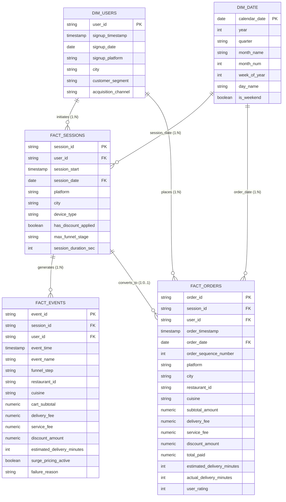

# Data Model & Star Schema Architecture
## Tableau & Power BI Data Architecture Specification

### 1. Conceptual & Logical Data Model
This architecture follows the Kimball Dimensional Modeling methodology for event-driven clickstream analytics, structured into a high-performance **Star / Constellation Schema**.

---

### 2. Table Relationships & Cardinality Table

| Relationship | From Table (Column) | To Table (Column) | Cardinality | Cross-Filter Direction | Role in Analytics |
| :--- | :--- | :--- | :--- | :--- | :--- |
| **User Cohort to Sessions** | `dim_users.user_id` | `fact_sessions.user_id` | 1 to Many (`1:*`) | Single (`dim_users` filters `fact_sessions`) | Slices funnel conversion by acquisition channel & persona |
| **User Cohort to Orders** | `dim_users.user_id` | `fact_orders.user_id` | 1 to Many (`1:*`) | Single (`dim_users` filters `fact_orders`) | Cohort retention (D1/D7/D30) & LTV repeat tracking |
| **Calendar to Sessions** | `dim_date.calendar_date` | `fact_sessions.session_date`| 1 to Many (`1:*`) | Single (`dim_date` filters `fact_sessions`) | Time intelligence (MoM, WoW trend analysis) |
| **Calendar to Orders** | `dim_date.calendar_date` | `fact_orders.order_date` | 1 to Many (`1:*`) | Single (`dim_date` filters `fact_orders`) | Sales and transaction velocity tracking |
| **Session to Events** | `fact_sessions.session_id` | `fact_events.session_id` | 1 to Many (`1:*`) | Single (`fact_sessions` filters `fact_events`) | Micro-conversion drop-off analysis |
| **Session to Orders** | `fact_sessions.session_id` | `fact_orders.session_id` | 1 to 1 (or 0..1) | Both Directions | Bridges session funnel context with realized transaction margins |

---

### 3. Optimization Guidelines
1. **Granularity Alignment**:
   - `fact_sessions` contains **one row per app session**, representing the primary denominator for top-of-funnel conversion.
   - `fact_events` contains **one row per user interaction telemetry**, used specifically for deep-dive diagnostics (fee sensitivity, item browsing, payment attempts).
   - In Power BI and Tableau, avoid joining `fact_events` to `fact_orders` directly. Always traverse through `dim_users` or `fact_sessions` to prevent fan-out / Cartesian multiplication of dollar metrics.
2. **Aggregated Summary Tables (Marts)**:
   - For ultra-fast interactive dashboards, pre-aggregate `funnel_summary.csv` and `cohort_retention.csv` to ensure sub-50ms dashboard response times.
